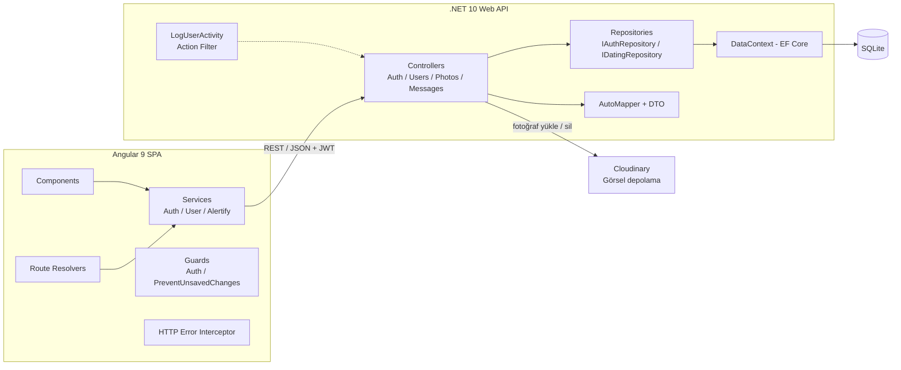
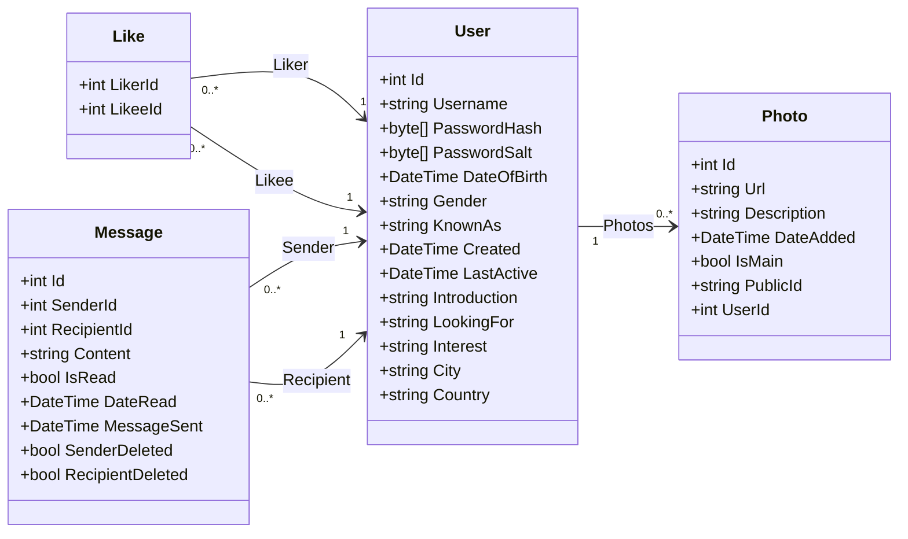
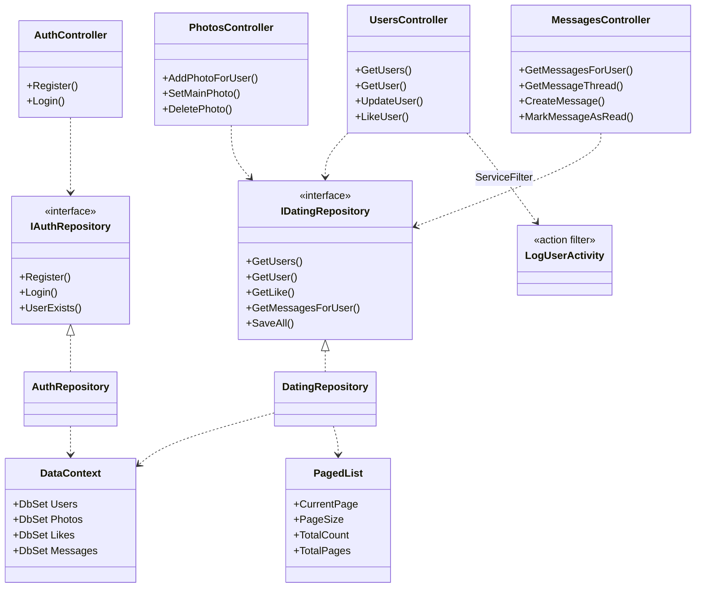
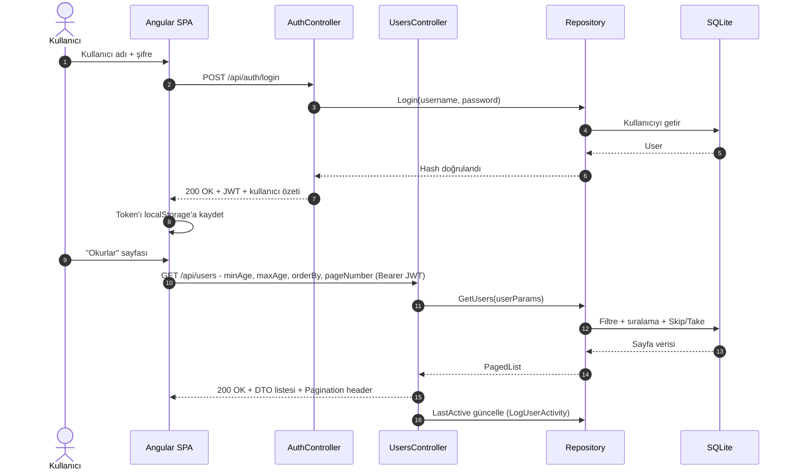
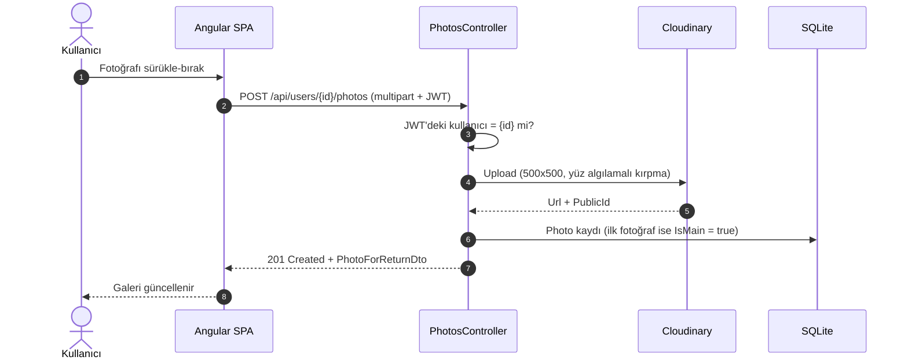

# 📚 Kim Okur?

> **Okurların birbirini keşfettiği, beğendiği ve mesajlaştığı tam yığın (full-stack) sosyal platform.**
> *A full-stack social platform where readers discover, like and message each other — built with ASP.NET Core and Angular.*


**Kim Okur?**, kayıt olan okurların profil oluşturup fotoğraf yükleyebildiği, filtreleyerek diğer okurları keşfedebildiği, beğenebildiği ve birbirine mesaj gönderebildiği bir web uygulamasıdır. Arka uçta **ASP.NET Core Web API (.NET 10)**, ön yüzde **Angular 9 SPA** bulunur; kimlik doğrulama **JWT**, görsel depolama **Cloudinary** ile yapılır.

---

## ✨ Özellikler

| Alan | Neler var? |
|---|---|
| **Üyelik & Güvenlik** | Kayıt formu (doğrulamalı, şifre tekrarı), JWT ile oturum, korumalı sayfalar (`AuthGuard`), şifreler HMAC-SHA512 + salt ile hash'lenir |
| **Okurları Keşfet** | Cinsiyete göre varsayılan eşleşme listesi, **yaş aralığı** filtresi, "Aktif zaman / Yeni üyeler" sıralaması, **sayfalama** |
| **Okur Profili** | Sekmeli detay sayfası (Hakkında, İlgilendikleri, Fotoğrafları, Yazışmalar), fotoğraf **galerisi**, **Beğen** ve **Hemen yaz** aksiyonları |
| **Profil Düzenleme** | Kullanıcı/profil bilgileri, kaydedilmemiş değişiklik uyarısı (`PreventUnsavedChangesGuard`) |
| **Fotoğraf Yönetimi** | Sürükle-bırak / çoklu yükleme, profil fotoğrafı seçme, silme (onay penceresiyle); yüz algılamalı 500×500 kırpma (Cloudinary) |
| **Listem** | Favori listesi: "Favorilediklerim" / "Favorilendiklerim", sayfalı |
| **Mesajlaşma** | Okunmamış / Gelen / Giden kutuları, konuşma akışı, okundu işaretleme, **soft-delete** (iki taraf da silince kayıt kalkar), göreli zaman gösterimi (`timeAgo` pipe) |

## 🖼️ Ekran Görüntüleri

| Açılış & Giriş | Giriş sonrası menü | Okurlar listesi |
|:---:|:---:|:---:|
|  |  |  |

| Okur detayı & galeri | Profil bilgileri | Fotoğraf yönetimi |
|:---:|:---:|:---:|
|  |  |  |

| Silme onayı | Silme başarılı | Profil fotoğrafı değişti |
|:---:|:---:|:---:|
|  |  |  |

**Üyelik formu doğrulamaları** — şifre 4–8 karakter olmalı, şifre tekrarı eşleşmeli, form eksikse **Kaydet** butonu pasif kalır:

| Boş form | Şifre uzunluğu | Şifre eşleşmesi |
|:---:|:---:|:---:|
|  |  |  |

---

## 🧰 Teknoloji Yığını

| Katman | Teknoloji |
|---|---|
| **Backend** | ASP.NET Core Web API (.NET 10), Entity Framework Core 10, AutoMapper, Newtonsoft.Json |
| **Veritabanı** | SQLite (EF Core Migrations ile) |
| **Kimlik Doğrulama** | JWT Bearer, HMAC-SHA512 parola hash'i |
| **Medya** | Cloudinary (CloudinaryDotNet) |
| **Frontend** | Angular 9 (Ivy), TypeScript 3.8, RxJS 6, ngx-bootstrap 5, Bootswatch/Bootstrap 4, @kolkov/ngx-gallery, ng2-file-upload, AlertifyJS |
| **CI/CD** | GitHub Actions (build + test + lint, otomatik etiketleme ve sürüm oluşturma, PR atama) |

---

## 🏗️ Mimari

İstemci (SPA) ile API REST/JSON üzerinden konuşur; her istekte JWT taşınır. API, katmanlı yapıdadır: **Controller → Repository → DbContext**. Varlıklar doğrudan dışarı verilmez, **DTO + AutoMapper** kullanılır.



### UML — Alan Modeli (Class Diagram)



> `Like` tablosu `(LikerId, LikeeId)` **bileşik anahtarına** sahiptir; `Like` ve `Message` ilişkilerinde silme davranışı `Restrict`'tir.

### UML — Backend Katmanları (Class Diagram)



### UML — Giriş ve Sayfalı Liste (Sequence Diagram)



### UML — Fotoğraf Yükleme (Sequence Diagram)



---

## 🔌 API Uç Noktaları

`/api/auth/*` dışındaki tüm uç noktalar `Authorization: Bearer <JWT>` ister.

| Yöntem | Yol | Açıklama |
|---|---|---|
| `POST` | `/api/auth/register` · `/api/auth/login` | Kayıt ol / JWT al |
| `GET` | `/api/users` | Filtreli (`minAge`, `maxAge`, `gender`, `orderBy`, `likers`, `likees`) ve sayfalı okur listesi |
| `GET` · `PUT` | `/api/users/{id}` | Okur detayı / profil güncelleme |
| `POST` | `/api/users/{id}/like/{recipientId}` | Okuru beğen |
| `POST` | `/api/users/{userId}/photos` | Fotoğraf yükle |
| `POST` · `DELETE` | `/api/users/{userId}/photos/{id}/setMain` · `/photos/{id}` | Profil fotoğrafı seç / fotoğraf sil |
| `GET` | `/api/users/{userId}/messages` · `/messages/thread/{recipientId}` | Mesaj kutusu (`Unread` · `Inbox` · `Outbox`) / konuşma akışı |
| `POST` | `/api/users/{userId}/messages` · `/messages/{id}/read` | Mesaj gönder / okundu işaretle |

---

## 💡 Öne Çıkan Mühendislik Kararları

- **Katmanlı API:** Controller → Repository (arayüzlerle, DI ile) → EF Core `DbContext`; varlık yerine **DTO** döndürme.
- **Sunucu taraflı sayfalama:** `PagedList<T>` + `Pagination` HTTP başlığı; SPA bu başlığı çözümleyip sayfalayıcıyı besler.
- **Yetkilendirme deseni:** Kullanıcıya özel uç noktalar, yoldaki `{id}` ile JWT'deki `NameIdentifier` claim'ini karşılaştırır.
- **Action filter:** `LogUserActivity` her yetkili istekte kullanıcının son aktif zamanını günceller.
- **Angular tarafında:** Route **resolver'lar** ile veri sayfa açılmadan yüklenir, **guard'lar** ile yetkisiz erişim ve kaydedilmemiş değişiklik kaybı engellenir, merkezi **HTTP hata interceptor'ı** kullanılır.
- **Modernizasyon:** Proje **.NET Core 2.2 → .NET 10**'a taşındı; Angular **8 → 9** geçişi yapıldı ve **adım adım Angular 22**'ye çıkış sürüyor. Ivy ile uyumsuz paketler değiştirildi (ngx-bootstrap 5, `@kolkov/ngx-gallery`, yerel `timeAgo` pipe).
- **CI/CD (GitHub Actions):** SPA için `npm ci` → `lint` → `test` → `build` iş akışı; PR'lara dal adına göre etiket atanır, `master`'a birleşince otomatik sürüm etiketi/release oluşturulur; PR'ı açan ve birleştiren kişi otomatik atanır.

---

## 🚀 Yerel Çalıştırma

**Gereksinimler:** .NET 10 SDK, Node.js **12–14** (Angular 9 / webpack 4 gereği; `nvm use 14` önerilir).

### 1) API

```bash
cd KimOkurAPP.API
dotnet user-secrets set "AppSettings:Token" "<en az 64 karakterlik rastgele bir anahtar>"
dotnet user-secrets set "CloudinarySettings:CloudName" "<cloud-name>"
dotnet user-secrets set "CloudinarySettings:ApiKey" "<api-key>"
dotnet user-secrets set "CloudinarySettings:ApiSecret" "<api-secret>"
dotnet run --urls http://localhost:5000
```

SQLite dosyası (`KimOkurAPP.db`) çalışma dizininden okunduğu için API'yi `KimOkurAPP.API/` klasöründen çalıştırın. Boş bir veritabanı için `Data/Seed.cs` örnek kullanıcıları (`UserSeedData.json`, varsayılan şifre `password`) yükler; çağrısı `Program.cs` içinde yorum satırındadır.

### 2) SPA

```bash
cd KimOkurAPP-SPA
npm install
npm start          # http://localhost:4200
```

SPA, API adresini `src/environments/environment.ts` içinden alır (`http://localhost:5000/api/`).

---

## 🗂️ Proje Yapısı

```
KimOkurAPP
├── KimOkurAPP.API/          # ASP.NET Core Web API
│   ├── Controllers/         # Auth, Users, Photos, Messages
│   ├── Data/                # DbContext, repository'ler, seed
│   ├── Dtos/ · Models/      # DTO'lar ve varlıklar
│   ├── Helpers/             # PagedList, filtre, AutoMapper profilleri
│   └── Migrations/          # EF Core migration'ları
├── KimOkurAPP-SPA/          # Angular SPA
│   └── src/app/             # members, messages, lists, nav, register, _services, _guards, _resolves
├── Tanitim/                 # Ekran görüntüleri
└── .github/workflows/       # CI/CD ve otomasyon
```

---

## 🛣️ Yol Haritası

- [ ] Angular 9 → 22 geçişi (her major sürüm için ayrı adım)
- [ ] SPA testlerinin ve `lint` hatalarının düzeltilmesi (CI'ın yeşile dönmesi), üretim `environment` ayarı
- [ ] Backend birim ve entegrasyon testleri (xUnit + `WebApplicationFactory`), CI'a `dotnet build/test` eklenmesi
- [ ] Minimal hosting'e geçiş, `System.Text.Json`, `ProblemDetails` ile standart hata yanıtları
- [ ] Gizli bilgilerin tamamen `user-secrets`/ortam değişkenlerine taşınması, ASP.NET Core Identity
- [ ] SPA'nın API üzerinden sunulması (Kestrel) ve üretim yapılandırması

---

## 👩‍💻 Geliştirici

**Nisanur** — [@NisanurBulut](https://github.com/NisanurBulut)
