<!-- Header banner in the app's own colours (Bootswatch "United": aubergine #772953 + orange #E95420) -->
<p align="center">
  
</p>

<p align="center">
  
</p>

<p align="center">
  
  
  
  
  <br/>
  
  
  
  
</p>

<p align="center">
  <a href="https://github.com/NisanurBulut/KimOkurAPP"></a>
  <a href="https://github.com/NisanurBulut/KimOkurAPP/fork"></a>
  <a href="https://github.com/NisanurBulut/KimOkurAPP/releases"></a>
  <a href="https://github.com/NisanurBulut/KimOkurAPP/commits"></a>
</p>

<p align="center">
  <a href="#features"><b>✨ Features</b></a> &nbsp;·&nbsp;
  <a href="#screenshots"><b>🖼️ Screenshots</b></a> &nbsp;·&nbsp;
  <a href="#architecture"><b>🏗️ Architecture</b></a> &nbsp;·&nbsp;
  <a href="#api"><b>🔌 API</b></a> &nbsp;·&nbsp;
  <a href="#upgrade-journey"><b>🧭 Upgrade Journey</b></a> &nbsp;·&nbsp;
  <a href="#getting-started"><b>🚀 Getting Started</b></a> &nbsp;·&nbsp;
  <a href="#roadmap"><b>🛣️ Roadmap</b></a> &nbsp;·&nbsp;
  <a href="#support"><b>⭐ Support</b></a>
</p>

---

**Kim Okur?** (*"Who reads?"*) lets registered readers build a profile, upload photos, discover other readers with filters, like them and send messages. The back end is an **ASP.NET Core Web API on .NET 10**, the front end is an **Angular 17 SPA**. Authentication uses **JWT**, images live on **Cloudinary**, and the API documents itself with **OpenAPI** and an interactive **Scalar** reference.

> [!NOTE]
> The application UI is in Turkish; code, API and documentation are in English.

> [!TIP]
> **Like what you see?** [⭐ Star the repository](https://github.com/NisanurBulut/KimOkurAPP) — it takes one click and helps other developers find this upgrade playbook, the release automation and the UML diagrams.

<table align="center">
  <tr>
    <td align="center" width="25%"><h2>.NET 10</h2><sub>API migrated from<br/>.NET Core 2.2</sub></td>
    <td align="center" width="25%"><h2>8 → 17</h2><sub>Angular majors upgraded<br/>one step at a time</sub></td>
    <td align="center" width="25%"><h2>6</h2><sub>Mermaid / UML diagrams<br/>in this README</sub></td>
    <td align="center" width="25%"><h2>3</h2><sub>GitHub Actions workflows<br/>CI · releases · PR automation</sub></td>
  </tr>
</table>

<a name="features"></a>

## ✨ Features

<table>
  <tr>
    <td width="50%" valign="top">
      <h3>🔐 Accounts &amp; Security</h3>
      Registration with validation and password confirmation, JWT sessions, protected routes (<code>AuthGuard</code>), passwords hashed with <b>HMAC-SHA512 + salt</b>.
    </td>
    <td width="50%" valign="top">
      <h3>🔎 Discover Readers</h3>
      Opposite-gender matches by default, <b>age range</b> filter, "Last active / New members" ordering and <b>server-side pagination</b>.
    </td>
  </tr>
  <tr>
    <td valign="top">
      <h3>👤 Reader Profile</h3>
      Tabbed detail page (About, Interests, Photos, Messages), a photo <b>gallery</b>, and <b>Like</b> / <b>Message</b> actions.
    </td>
    <td valign="top">
      <h3>✏️ Profile Editing</h3>
      User and profile details with an <b>unsaved-changes guard</b> (<code>PreventUnsavedChangesGuard</code>).
    </td>
  </tr>
  <tr>
    <td valign="top">
      <h3>📸 Photo Management</h3>
      Drag-and-drop and multi-file upload, set main photo, delete with confirmation; <b>face-aware 500×500 crop</b> on Cloudinary.
    </td>
    <td valign="top">
      <h3>❤️ Favourites</h3>
      "Readers I liked" and "Readers who liked me" lists, paginated.
    </td>
  </tr>
  <tr>
    <td valign="top">
      <h3>💬 Messaging</h3>
      Unread / Inbox / Outbox, conversation thread, mark as read, <b>soft delete</b> (removed only when both sides delete), relative timestamps.
    </td>
    <td valign="top">
      <h3>📘 Self-documenting API</h3>
      OpenAPI document generated at runtime and an interactive <b>Scalar</b> reference in development.
    </td>
  </tr>
</table>

<a name="screenshots"></a>

## 🖼️ Screenshots

<table>
  <tr>
    <td align="center">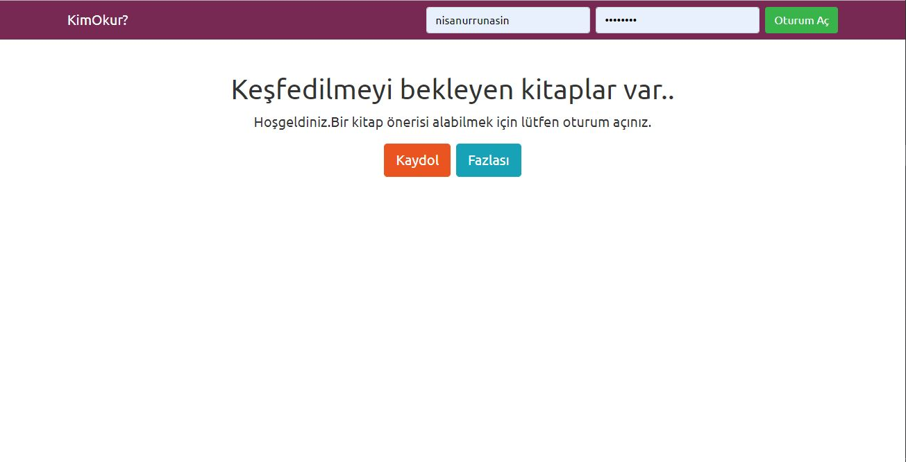<br/><sub><b>Landing &amp; login</b></sub></td>
    <td align="center">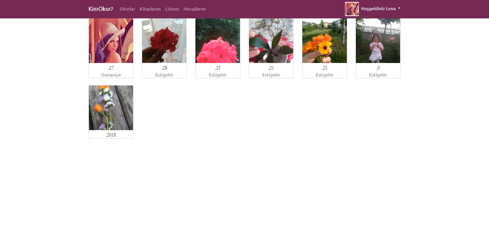<br/><sub><b>Readers list</b></sub></td>
    <td align="center"><br/><sub><b>Reader detail &amp; gallery</b></sub></td>
  </tr>
  <tr>
    <td align="center">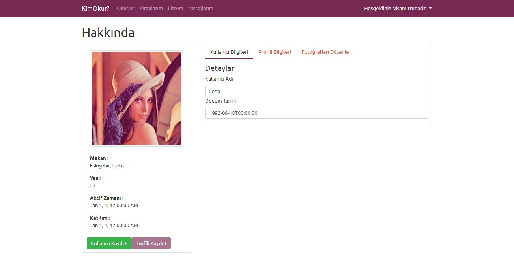<br/><sub><b>Profile details</b></sub></td>
    <td align="center">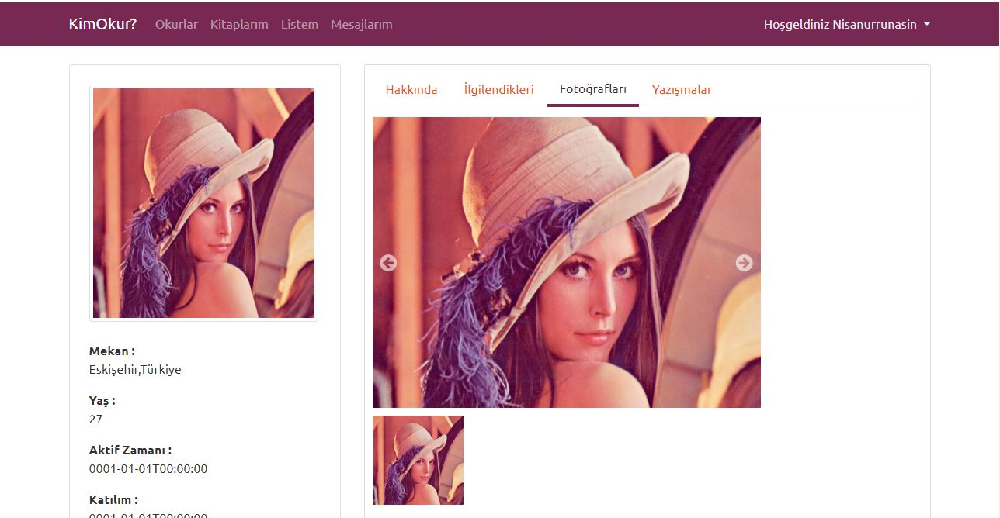<br/><sub><b>Photo management</b></sub></td>
    <td align="center">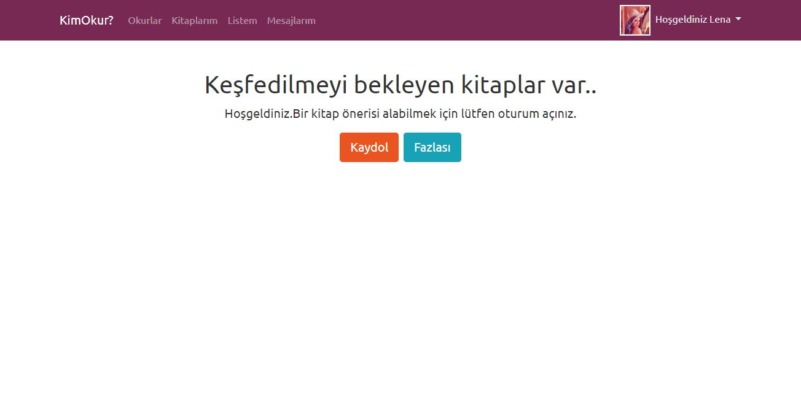<br/><sub><b>Menu after login</b></sub></td>
  </tr>
</table>

<details>
<summary><b>📷 More screenshots — photo actions and registration validation</b></summary>
<br/>

<table>
  <tr>
    <td align="center">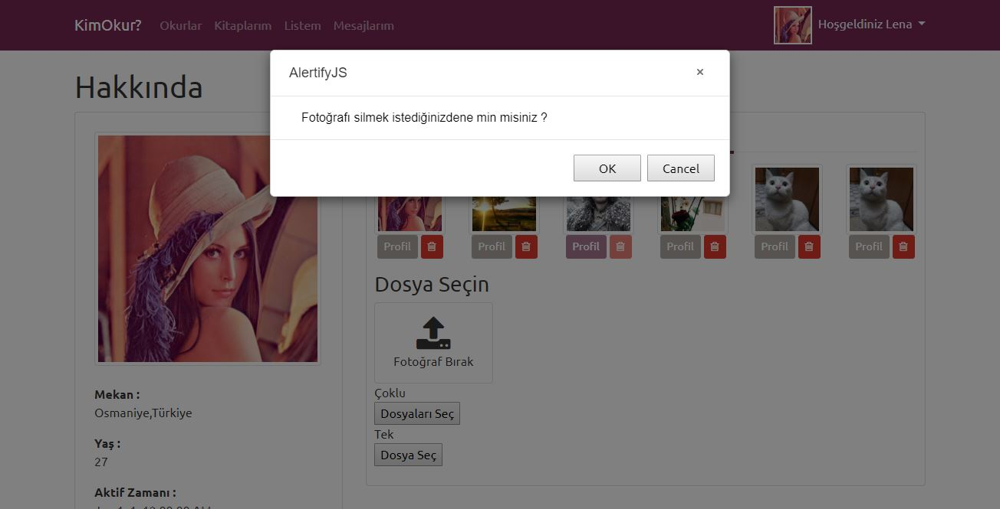<br/><sub>Delete confirmation</sub></td>
    <td align="center">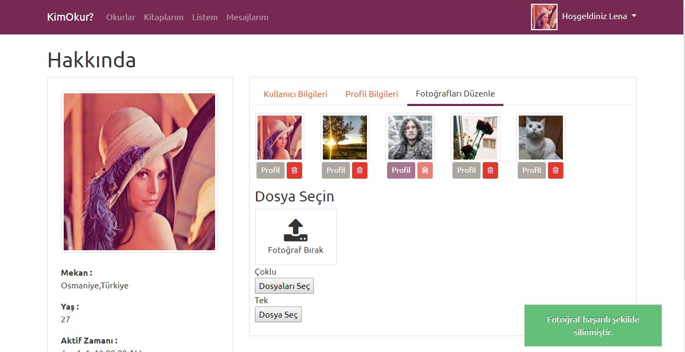<br/><sub>Delete succeeded</sub></td>
    <td align="center">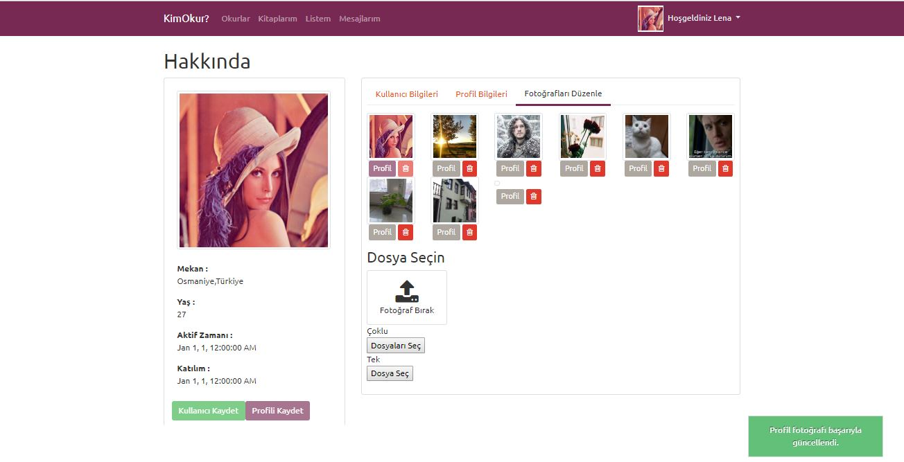<br/><sub>Main photo changed</sub></td>
  </tr>
  <tr>
    <td align="center">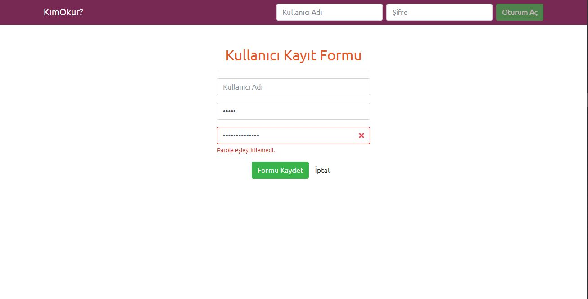<br/><sub>Empty form</sub></td>
    <td align="center">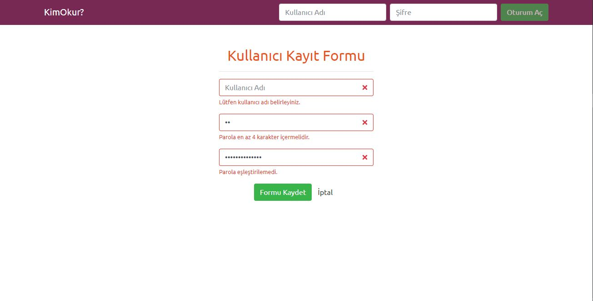<br/><sub>Password must be 4–8 characters</sub></td>
    <td align="center">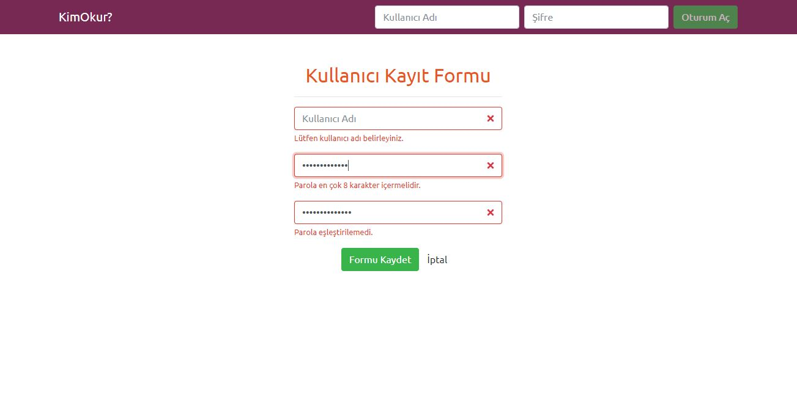<br/><sub>Confirmation must match; <b>Save</b> stays disabled</sub></td>
  </tr>
</table>
</details>

<a name="tech-stack"></a>

## 🧰 Tech Stack

<p align="center">
  
</p>

| Layer | Technology |
|---|---|
| ⚙️ **Backend** | ASP.NET Core Web API (.NET 10), Entity Framework Core 10, AutoMapper, Newtonsoft.Json |
| 📘 **API docs** | `Microsoft.AspNetCore.OpenApi` + **Scalar.AspNetCore** |
| 🗄️ **Database** | SQLite with EF Core migrations |
| 🔐 **Authentication** | JWT Bearer, HMAC-SHA512 password hashing |
| ☁️ **Media** | Cloudinary (CloudinaryDotNet) |
| 🅰️ **Frontend** | Angular 17 (Ivy, webpack 5), TypeScript 5.4, RxJS 7, ngx-bootstrap 12, Bootswatch (United), ng-gallery + Angular CDK, ng2-file-upload, AlertifyJS |
| 🧹 **Code quality** | ESLint with `@angular-eslint` (TypeScript + template rules) |
| 🚦 **CI/CD** | GitHub Actions — SPA build/lint/test, automatic semantic releases, PR labelling and assignment |

<a name="architecture"></a>

## 🏗️ Architecture

The SPA talks to the API over REST/JSON and sends a JWT with every request. The API is layered — **Controller → Repository → DbContext** — and never exposes entities directly; **DTOs + AutoMapper** shape every response. In development the API also publishes an OpenAPI document that Scalar renders.

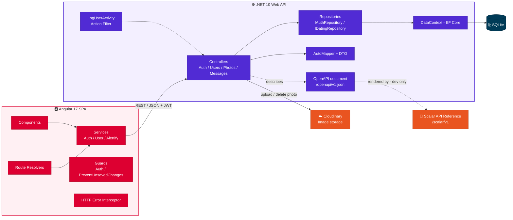

<a name="uml"></a>

### 🧩 UML — Domain Model

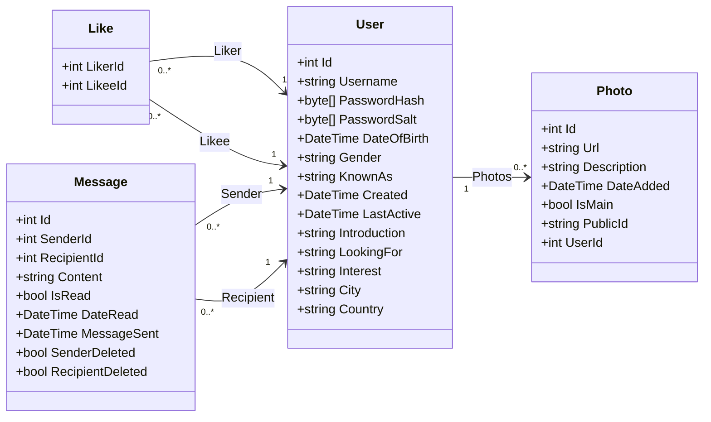

> [!TIP]
> `Like` uses the **composite key** `(LikerId, LikeeId)`; the `Like` and `Message` relationships use `DeleteBehavior.Restrict`.

### 🧱 UML — Backend Layers

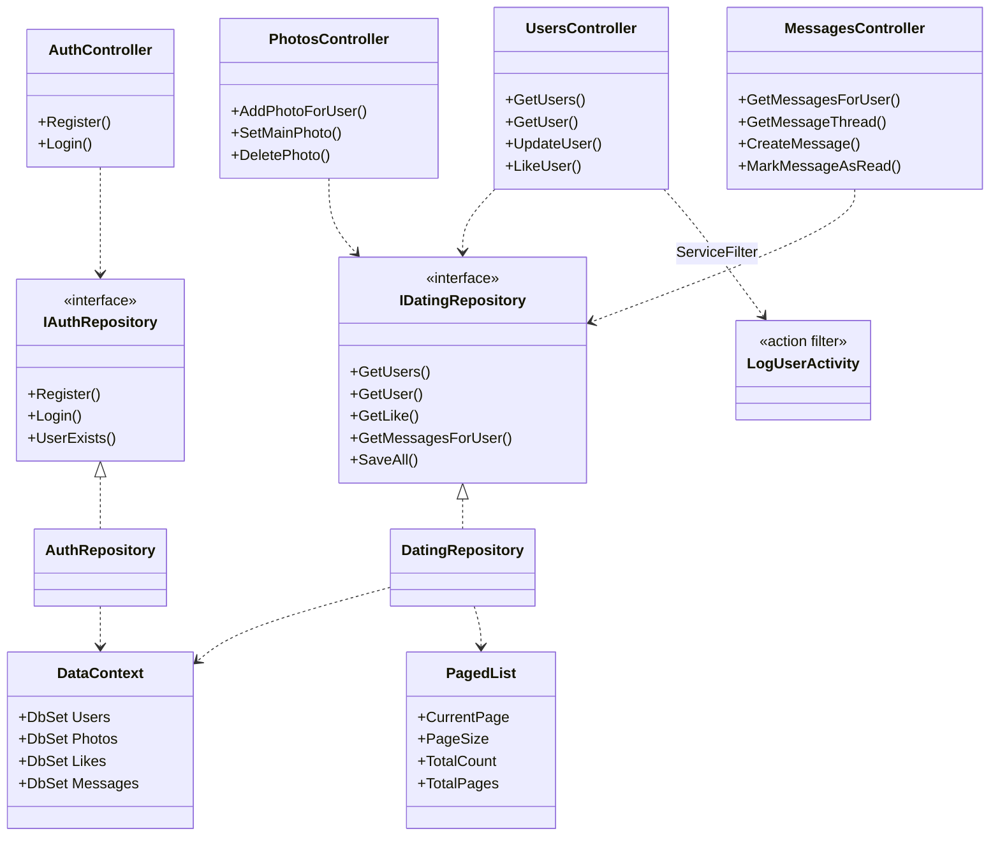

### 🔄 UML — Login and Paged List

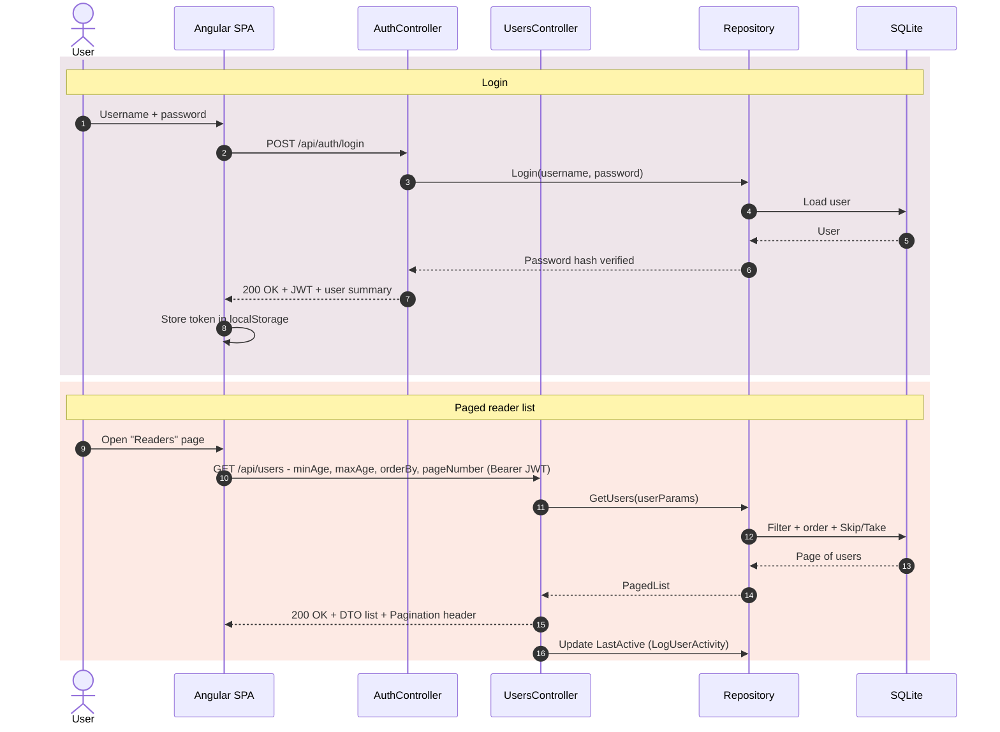

### 📤 UML — Photo Upload

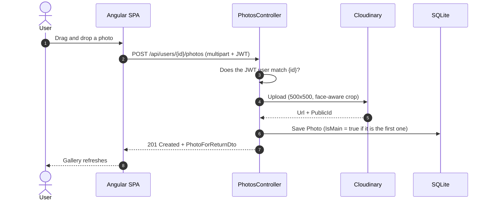

<a name="api"></a>

## 🔌 API Reference

In development the API serves an interactive reference built with **OpenAPI + Scalar**:

| | URL | Purpose |
|:---:|---|---|
| 📘 | `http://localhost:5000/scalar/v1` | Scalar API reference — opened automatically by the `KimOkur.API` launch profile |
| 📄 | `http://localhost:5000/openapi/v1.json` | Raw OpenAPI document |

> [!IMPORTANT]
> Both are mapped only when `ASPNETCORE_ENVIRONMENT=Development`. All endpoints except `/api/auth/*` require `Authorization: Bearer <JWT>` — get a token from `POST /api/auth/login`.

| Method | Path | Description |
|---|---|---|
|  | `/api/auth/register` · `/api/auth/login` | Register / obtain a JWT |
|  | `/api/users` | Paged reader list with filters (`minAge`, `maxAge`, `gender`, `orderBy`, `likers`, `likees`) |
|   | `/api/users/{id}` | Reader details / update profile |
|  | `/api/users/{id}/like/{recipientId}` | Like a reader |
|  | `/api/users/{userId}/photos` | Upload a photo |
|   | `/api/users/{userId}/photos/{id}/setMain` · `/photos/{id}` | Set main photo / delete a photo |
|  | `/api/users/{userId}/messages` · `/messages/thread/{recipientId}` | Mailbox (`Unread` · `Inbox` · `Outbox`) / conversation thread |
|  | `/api/users/{userId}/messages` · `/messages/{id}/read` | Send a message / mark as read |

<a name="highlights"></a>

## 💡 Engineering Highlights

- 🧱 **Layered API** — Controller → Repository (interfaces + DI) → EF Core `DbContext`; DTOs instead of entities.
- 📑 **Server-side pagination** — `PagedList<T>` plus a `Pagination` HTTP header that the SPA parses to drive the pager.
- 🛡️ **Authorization pattern** — user-scoped endpoints compare the route `{id}` with the JWT `NameIdentifier` claim.
- ⏱️ **Action filter** — `LogUserActivity` updates the user's last-active time on every authorized request.
- 📘 **Self-documenting API** — runtime OpenAPI document and a Scalar UI, enabled in development only.
- 🅰️ **Angular patterns** — route **resolvers** pre-load data, **guards** block unauthorized access and unsaved-changes loss, a central **HTTP error interceptor** handles failures.
- 🔁 **Modernization** — **.NET Core 2.2 → .NET 10** and **Angular 8 → 17**, documented step by step in the [Upgrade Journey](#upgrade-journey).
- 🚦 **Release automation** — every merged PR becomes a GitHub release with a semantic version: a branch named `*major*` or the `breaking` label bumps **major**, `enhancement` bumps **minor**, anything else bumps **patch**. PRs are labelled from their branch name and auto-assigned to their author and merger.

<a name="upgrade-journey"></a>

## 🧭 Angular Upgrade Journey: 8 → 17

The SPA started on **Angular 8 (2019)**. Instead of jumping versions, it was upgraded **one major release at a time**: `ng update`, review the migration diff, fix incompatible libraries, then prove the result with a build, an AOT compile and a browser smoke test before moving on. The path continues toward Angular 22.

```mermaid
flowchart LR
    A8["Angular 8<br/>View Engine · TS 3.5"] --> A9["Angular 9<br/>Ivy · TS 3.8"]
    A9 --> A10["Angular 10<br/>tslib 2 · TS 4.0"]
    A10 --> A11["Angular 11<br/>waitForAsync"]
    A11 --> A12["Angular 12<br/>webpack 5 · TS 4.3"]
    A12 --> A13["Angular 13<br/>ESLint · TS 4.6"]
    A13 --> A14["Angular 14<br/>Typed forms"]
    A14 --> A15["Angular 15<br/>RxJS 7 · TS 4.9"]
    A15 --> A16["Angular 16<br/>No ngcc · Ivy libs"]
    A16 --> A17["Angular 17<br/>TS 5.4 · Node 20+"]
    A17 -.->|"planned"| NEXT["Angular 18 to 22"]

    classDef old fill:#9E9E9E,stroke:#616161,color:#ffffff
    classDef step fill:#772953,stroke:#4E1B37,color:#ffffff
    classDef now fill:#DD0031,stroke:#A3001F,color:#ffffff,stroke-width:3px
    classDef next fill:#ffffff,stroke:#E95420,color:#E95420,stroke-dasharray:5 5
    class A8 old
    class A9,A10,A11,A12,A13,A14,A15,A16 step
    class A17 now
    class NEXT next
```

| Step | Angular | CLI | TypeScript | Highlights |
|:---:|:---:|:---:|:---:|---|
|  | 8.2 | 8.3 | 3.5 | View Engine compiler, webpack 4 |
|  | 9.1.13 | 9.1.15 | 3.8.3 | **Ivy** becomes the default compiler |
|  | 10.2.5 | 10.2.4 | 4.0.8 | tslib 2, TSLint 6, CommonJS warnings, new `tsconfig` targets |
|  | 11.2.14 | 11.2.19 | 4.0.8 | `waitForAsync`, router link-resolution migration, TSLint deprecated |
|  | 12.2.17 | 12.2.18 | 4.3.5 | **webpack 5**, production-by-default builds, zone.js 0.11 |
|  | 13.4.0 | 13.3.11 | 4.6.4 | View Engine removed, IE 11 dropped, **TSLint → ESLint**, persistent build cache |
|  | 14.3.0 | 14.2.13 | 4.6.4 | **Typed forms**, strict `pathMatch` types, ES2020 target, `^` version ranges |
|  | 15.2.10 | 15.2.11 | 4.9.5 | **RxJS 7**, ES2022 target, router `relativeLinkResolution` removed, CI-identical installs |
|  | 16.2.12 | 16.2.16 | 4.9.5 | **ngcc removed** — every library on Ivy, deprecated guard/resolver interfaces dropped |
|  | 17.3.12 | 17.3.17 | 5.4.5 | **TypeScript 5**, zone.js 0.14, `buildTarget`, Node 20/22 support, new control flow available |

<details open>
<summary><b>① Angular 8 → 9 — Ivy arrives</b></summary>
<br/>

Angular 9 switched the compiler to **Ivy**, which is where most of the real work was.

- **Toolchain first.** Angular 9 builds on webpack 4, which fails on Node 17+ with `ERR_OSSL_EVP_UNSUPPORTED`, so the build runs on **Node 14** managed with `nvm`.
- **`ng update` quirk.** From an old local CLI, `ng update` tried to download the *latest* CLI, which needs a far newer Node. The update-runner check was bypassed temporarily to finish the migration.
- **Ivy-incompatible libraries replaced:**
  - `ngx-bootstrap` 3 crashed NGCC → upgraded to **5.6.2** with sub-path imports (`ngx-bootstrap/tabs`, `/datepicker`, …).
  - `ngx-gallery` used the removed `Renderer` API → moved to the maintained fork **`@kolkov/ngx-gallery`**.
  - `ng2-file-upload` 1.3 → **1.4.0**.
  - `time-ago-pipe` could not be declared under Ivy → rewritten as a small **local `timeAgo` pipe** with the same behaviour.
- **A latent bug surfaced.** Ivy's stricter template type-checking exposed a typing mistake (`messageContainer: 'Unread'` instead of `string`) that had silently passed before.
- ✅ **Result:** clean AOT build; app verified in the browser.

</details>

<details>
<summary><b>② Angular 9 → 10 — cleaner defaults</b></summary>
<br/>

- Upgraded to Angular **10.2.5**, TypeScript **4.0.8**, **tslib 2**, TSLint 6, Karma 5 and Protractor 7.
- Migrations moved `browserslist` to **`.browserslistrc`** and updated `tsconfig` to `target: es2018` / `module: es2020`.
- Angular 10 started **warning about CommonJS dependencies** (`alertifyjs`, and `url` inside `@auth0/angular-jwt`). They were allow-listed explicitly with `allowedCommonJsDependencies`, taking the build to **0 warnings**.
- From CLI 10 on, `ng update` runs the migrations with the *target* version's CLI, so the earlier workaround was no longer needed.

</details>

<details>
<summary><b>③ Angular 10 → 11 — migrations that rewrite your tests</b></summary>
<br/>

- Upgraded to Angular **11.2.14**.
- Automatic migrations: `async` → **`waitForAsync`** in all **15 spec files**, `relativeLinkResolution: 'legacy'` added to the router config to **preserve existing behaviour**, and the obsolete `extractCss` option removed.
- TSLint was officially **deprecated** in this release — recorded as a follow-up (ESLint migration).
- 💡 **Lesson learned:** bumping versions by hand in `package.json` made `npm ci` fail (lockfile out of sync) and skipped the migrations entirely. The step was redone from a clean state with the proper `ng update` flow, and the rule is now documented for future upgrades.

</details>

<details>
<summary><b>④ Angular 11 → 12 — webpack 5</b></summary>
<br/>

- Upgraded to Angular **12.2.17**, TypeScript **4.3.5**, **webpack 5.50** and zone.js 0.11.
- Migrations updated the zone.js entry points (`zone.js`, `zone.js/testing`) and `angular.json`: the old `aot` flag was dropped (now the default) and `defaultConfiguration: ""` keeps `ng build` behaving as before, since Angular 12 builds for production by default.
- **The hard part was the tooling, not Angular.** npm 6 (bundled with Node 14) crashed on Windows with `ENOENT … rename` halfway through the install and left a corrupted `node_modules`. The fix was a clean install with **npm 8** (`--legacy-peer-deps`, lockfile v2 stays readable by npm 6), then running the Angular migrations separately with `ng update … --migrate-only`.
- ✅ **Result:** clean build, **`ng lint` with 0 errors**, and a smaller dev bundle (initial ES2015 total **5.07 MB → 4.73 MB**, Angular 11 → 12).

</details>

<details>
<summary><b>⑤ Angular 12 → 13 — goodbye View Engine, hello ESLint</b></summary>
<br/>

- Upgraded to Angular **13.4.0**, CLI **13.3.11** and TypeScript **4.6.4**.
- **Lessons from step ④ applied up front:** npm 8 was placed first on the `PATH` and `legacy-peer-deps` enabled before running `ng update`, so the whole upgrade — temporary CLI, package install and migrations — ran in a single pass with no broken `node_modules`.
- Migrations removed the **Internet Explorer polyfills** (IE 11 support ended), cleaned obsolete `angular.json` options, added **`.angular/cache`** (the new persistent build cache) to `.gitignore`, and set the `TestBed` **`teardown`** option explicitly so tests keep their current behaviour.
- **TSLint is gone.** Angular 13 removed the TSLint builder, so `ng lint` — and the CI step that runs it — stopped working. Linting was migrated to **ESLint** with `@angular-eslint`: TSLint, Codelyzer and `tslint.json` were removed and `tslint:disable` comments were converted to their ESLint equivalents.
- **ESLint found real issues TSLint never checked:** loose `==` / `!=` comparisons in templates and empty `ngOnInit` hooks. Each comparison was reviewed — both sides always had the same type — before switching to `===` / `!==`, and the empty hooks were removed. Result: **"All files pass linting."**
- ✅ **Result:** clean build; with IE 11 gone there is no separate ES5 bundle any more — a single initial bundle of **4.46 MB** (vs. 4.73 MB for the ES2015 bundle on Angular 12) — and a verified browser smoke test.

</details>

<details>
<summary><b>⑥ Angular 13 → 14 — typed forms</b></summary>
<br/>

- Upgraded to Angular **14.3.0**, CLI **14.2.13** and `@angular-eslint` **14.4.0**, on a dedicated `major_*` branch so the merge produces a new **major release** automatically.
- **Peer-dependency check caught two blockers before anything was installed:**
  - `@angular-eslint/schematics` 13 only allows CLI 13 → upgraded in the **same `ng update` run** (`@angular-eslint/schematics@14`), which also migrated its config.
  - `@kolkov/ngx-gallery` has no Angular 14 release. It was first moved to **2.0.1** (Ivy-compiled, officially Angular 13) and verified with a build **while still on Angular 13**; only then was the remaining peer warning overridden.
- **Gallery replaced.** Right after the upgrade the unmaintained gallery was swapped for **[`ng-gallery`](https://github.com/MurhafSousli/ngx-gallery)** 7.1.2 (MIT, actively maintained, with a release line for every Angular version up to 22) plus `@angular/cdk` 14. The reader page now builds its slides with typed `ImageItem`s, and future `ng update` runs no longer need `--force`.
- **End-to-end test found a hidden bug.** The gallery was tested for real — API running, logged in, reader profile open — and the console showed that **`BrowserAnimationsModule` had never been imported**. That broke the gallery's fade-in *and* the navbar's ngx-bootstrap dropdown (`No provider for AnimationBuilder`), a bug that had been silently present since the Angular 9 upgrade but only appears after login. Importing the module fixed both: slides, thumbnails, next/prev navigation and the user menu work with a clean console.
- **Typed forms:** Angular 14 adds type parameters to `FormGroup` / `FormControl`. The migration opted the registration form out (`UntypedFormGroup`, `UntypedFormBuilder`) to keep behaviour identical — then the form was checked in the browser: password mismatch still shows *"Parola eşleştirilemedi."* and **Save** stays disabled.
- Other migrations: strict `pathMatch: 'full' | 'prefix'` types, `defaultProject` removed from `angular.json`, TypeScript target **ES2020**, and Angular dependencies switched from `~` to `^` ranges.
- ✅ **Result:** clean build and **ESLint passes**. The Angular 14 upgrade alone shrank the initial bundle to **4.24 MB** (from 4.46 MB); with the animations module and the new gallery it is **4.41 MB**.

</details>

<details>
<summary><b>⑦ Angular 14 → 15 — RxJS 7, CI-identical installs and a real JWT fix</b></summary>
<br/>

- Upgraded to Angular **15.2.10**, CLI **15.2.11**, TypeScript **4.9.5**, `@angular/cdk` **15.2.9**, `@angular-eslint` **15.2.1** and `ng-gallery` **8.0.4**, on a fresh `major_*` branch cut from the updated `master`.
- **A resolver trap:** passing `@angular/cdk@15` in the same `ng update` call made the resolver try to pull **Angular 16** packages. Splitting it into two runs (core + CLI + ESLint first, then CDK) kept everything on 15.
- Migrations removed the router's `relativeLinkResolution` option, dropped the old `require.context` test bootstrap, and moved the TypeScript target to **ES2022** with `useDefineForClassFields: false` to keep class-field semantics. Navigation (member cards, navbar, tabs) was re-checked after the router change.
- **Installs now match CI exactly.** Earlier steps installed with `legacy-peer-deps`, which skipped peer dependencies — the Angular 15 build then failed with `Cannot find module 'webpack'`. The lockfile was regenerated on **Node 18 / npm 10 with strict peer checks**, the same way GitHub Actions runs `npm ci`.
- **RxJS 6 → 7.** `ng-gallery` 8 imports operators from the `rxjs` root, which needs RxJS 7.2+ (its declared `rxjs >=6` range hid this). After upgrading to **RxJS 7.8**, the stricter types exposed three route resolvers that claimed to return `User[]` / `Message[]` while actually returning paginated results — their types were corrected to `PaginatedResult<…>`.
- **Backend: login fixed for real.** The committed JWT key was too short for current IdentityModel (`IDX10720`), and the API signed tokens with UTF-8 but validated them with ASCII. A single `JwtSigningKey` helper now feeds both sides and fails fast with a clear message; local development reads a strong random key from `dotnet user-secrets` instead of `appsettings.json`.
- ✅ **Result:** clean build with **0 warnings**, ESLint passes, initial bundle **4.41 MB**, and a full end-to-end run — login, paginated member list, profile, photo gallery, favourites and messages pages — with a clean console.

</details>

<details>
<summary><b>⑧ Angular 15 → 16 — no more ngcc: every library on Ivy</b></summary>
<br/>

- Upgraded to Angular **16.2.12**, CLI **16.2.16**, `@angular/cdk` **16.2.14**, `@angular-eslint` **16.3.1**, `ng-gallery` **11.0.0** and zone.js **0.13**, on a fresh `major_*` branch cut from the updated `master`.
- **The big change: Angular 16 removed `ngcc`**, the compatibility compiler that had silently kept old View Engine libraries alive since Angular 9. Three dependencies still shipped in that format, so they would stop working:

  | Library | Before (View Engine) | Ivy on Angular 15 | Angular 16 |
  |---|---|---|---|
  | `ngx-bootstrap` | 5.6.2 | 10.3.0 | **11.0.2** |
  | `ng2-file-upload` | 1.4.0 | 4.0.0 | **5.0.0** |
  | `@auth0/angular-jwt` | 3.0.0 | **5.2.0** | 5.2.0 |

- **Same playbook as step ⑥:** the libraries were moved to their Ivy releases *while still on Angular 15* and verified with a build first, so any breakage could be told apart from the Angular upgrade. A scan of `node_modules` confirmed no package needed `ngcc` any more before `ng update` ran.
- **Library API changes handled:**
  - `angular-jwt` 5 renamed `whitelistedDomains` / `blacklistedRoutes` to `allowedDomains` / `disallowedRoutes`. Keeping the old names would have silently stopped attaching the token — every API call would have returned 401.
  - `ngx-bootstrap` 10+ guesses Bootstrap 4 vs 5 from the page's CSS; the app now states `setTheme('bs4')` explicitly to match its Bootswatch theme.
- Migrations removed the `CanActivate` / `Resolve` interfaces (deprecated since Angular 15.2) from 2 guards and 6 resolvers; the classes keep working. `@angular-eslint` 16 no longer loads the `@typescript-eslint` plugin implicitly, so it is registered explicitly in `.eslintrc.json`.
- **End-to-end test found a real regression:** on the profile edit page the birthday showed *"Invalid date"* and the console logged `sourceDate.getTime is not a function` — `ngx-bootstrap` 11's datepicker needs a `Date`, but the API sends an ISO string. The value is now converted on load, and on save it is sent as a time-zone-free calendar date, because `Date.toJSON()` converts to UTC and would have moved the birthday to the **previous day** in Turkey (UTC+3). Saving was re-tested: the API still returns `1990-01-01`.
- ✅ **Result:** clean build, ESLint passes, strict `npm ci` passes, and an end-to-end run covering login, datepicker, sorting buttons, paging, navbar dropdown, profile tabs and save, photo upload area, gallery and mailbox buttons — with a clean console. The initial bundle is **4.50 MB** (4.29 MB with the Ivy libraries on Angular 15).

</details>

<details>
<summary><b>⑨ Angular 16 → 17 — TypeScript 5 and a gallery that changed its defaults</b></summary>
<br/>

- Upgraded to Angular **17.3.12**, CLI **17.3.17**, **TypeScript 5.4.5**, zone.js **0.14**, `@angular/cdk` **17.3.10** and `@angular-eslint` **17.5.3** (with `@typescript-eslint` 7), on a fresh `major_*` branch cut from the updated `master`.
- **Libraries in lockstep:** `ngx-bootstrap` **12** and `ng2-file-upload` **6** only accept Angular 17, so they went into the **same `ng update` call** as the framework; the CDK followed in its own run (the step ⑦ lesson), then `ng-gallery` moved to its Angular 17 line, **12.0.0**.
- Migrations were light: `browserTarget` → **`buildTarget`** in `angular.json`, and a check that no template uses `@` or `}` literally, because Angular 17 reserves them for the new **built-in control flow** (`@if`, `@for`). Converting `*ngIf` / `*ngFor` to the new syntax is optional and kept out of this step so the diff stays an upgrade, not a rewrite.
- **Node 22 is officially supported now.** Angular 17 accepts Node `^18.13 || >=20.9`, so the Node 22 used by GitHub Actions is inside the supported range for the first time.
- **End-to-end test caught a silent visual change:** after the upgrade the reader's photo tab showed a single large image with no thumbnail strip and no `1 / 2` counter. Nothing failed — `ng-gallery` 12 simply switched **thumbnails and the counter off by default**. Both are now enabled explicitly in the template, and clicking a thumbnail was re-tested (`1 / 2` → `2 / 2`).
- **Registration had the same birthday bug as step ⑧.** A reader who picked *18 January 1995* was stored as **17 January**: the registration form still sent the datepicker's `Date` through `Date.toJSON()` (UTC). The time-zone-free conversion from step ⑧ now lives in one shared helper (`_helpers/local-date.ts`) used by both registration and profile save; a new registration was re-tested and the API returns `1995-01-18`.
- ✅ **Result:** clean build, ESLint passes, strict `npm ci` passes, headless Karma runs green, and an end-to-end run — registration with the datepicker's year/month/day views, login, sorting, paging, navbar menu, reader profile and gallery, profile save (birthday kept), photo upload area, mailbox and favourites — with a clean console. The initial bundle is **4.81 MB**.

</details>

#### ✅ What was verified at every step

| Check | Result |
|---|---|
| `ng build` (AOT / Ivy) | ✅ passes on every version |
| Browser smoke test (`ng serve`: home page, registration form, datepicker, console) | ✅ no errors |
| End-to-end check on Angular 14–17 (API running, registration, login, member list paging and sorting, reader profile, photo gallery, profile edit and save, favourites, messages, navbar menu) | ✅ no errors |
| Clean `npm ci` with strict peer dependencies (Node 18 / npm 10, as in CI) | ✅ from Angular 15 on |
| `ng lint` | ✅ ESLint: all files pass on Angular 13–17 (TSLint with 0 errors up to Angular 12) |
| Unit tests | ⏳ the failing Angular CLI scaffold specs were removed on Angular 16; the Karma/Jasmine setup is kept (empty runs pass, CI uses headless Chrome) and real tests are next on the roadmap |
| Production build | ⚠️ needs an `apiUrl` in `environment.prod.ts` — on the roadmap |

#### 📋 Upgrade playbook

1. Start from a green state: `package.json` and `package-lock.json` agree, `npm ci` works and the app builds.
2. `ng update @angular/core@N @angular/cli@N` — never bump versions by hand.
3. Read the migration output and the `git diff` to see exactly what was rewritten.
4. Replace or upgrade libraries that are not compatible with the new Angular version.
5. Verify: AOT build, lint, unit tests and a real browser smoke test.
6. Update the documentation, then move to the next major.

<a name="getting-started"></a>

## 🚀 Getting Started

> [!WARNING]
> **Node.js 18.13+ or 20.9+ is required** for Angular 17 (`nvm use 20` or `nvm use 18`); CI runs on Node 22. You also need the **.NET 10 SDK**.

### 1️⃣ API

```bash
cd KimOkurAPP.API
dotnet user-secrets set "AppSettings:Token" "<random key, at least 64 characters>"
dotnet user-secrets set "CloudinarySettings:CloudName" "<cloud-name>"
dotnet user-secrets set "CloudinarySettings:ApiKey" "<api-key>"
dotnet user-secrets set "CloudinarySettings:ApiSecret" "<api-secret>"
dotnet run --urls http://localhost:5000
```

Then open **http://localhost:5000/scalar/v1** to explore the API.

> [!TIP]
> The SQLite file (`KimOkurAPP.db`) is resolved from the working directory, so run the API from `KimOkurAPP.API/`. For an empty database, `Data/Seed.cs` loads sample users (`UserSeedData.json`, default password `password`); its call is commented out in `Program.cs`.

### 2️⃣ SPA

```bash
cd KimOkurAPP-SPA
npm install
npm start          # http://localhost:4200
```

The SPA reads the API address from `src/environments/environment.ts` (`http://localhost:5000/api/`).

<a name="structure"></a>

## 🗂️ Project Structure

```
KimOkurAPP
├── KimOkurAPP.API/          # ASP.NET Core Web API
│   ├── Controllers/         # Auth, Users, Photos, Messages
│   ├── Data/                # DbContext, repositories, seed
│   ├── Dtos/ · Models/      # DTOs and entities
│   ├── Helpers/             # PagedList, filters, AutoMapper profiles
│   └── Migrations/          # EF Core migrations
├── KimOkurAPP-SPA/          # Angular SPA
│   └── src/app/             # members, messages, lists, nav, register, _services, _guards, _resolves
├── Tanitim/                 # Screenshots
└── .github/workflows/       # CI, releases and PR automation
```

<a name="roadmap"></a>

## 🛣️ Roadmap

- [x] Migrate the API from .NET Core 2.2 to .NET 10
- [x] Upgrade the SPA from Angular 8 to Angular 17
- [x] Migrate linting from TSLint to ESLint
- [x] Interactive API documentation with OpenAPI + Scalar
- [x] Automatic semantic releases and PR labelling/assignment
- [x] Replace the unmaintained `@kolkov/ngx-gallery` with `ng-gallery`
- [x] Fix JWT signing (strong key via user-secrets, one shared key helper)
- [x] Reproducible installs with strict peer dependencies, matching CI
- [x] Every library on Ivy — no `ngcc` / View Engine dependencies left
- [ ] Angular 17 → 22 upgrade (one major version at a time)
- [ ] Fix the `MessagesController` route conflict so sending and deleting messages works
- [x] Remove the failing Angular CLI scaffold specs (test setup kept for real tests)
- [ ] Write real unit tests for the SPA (services, guards, resolvers, components)
- [ ] Add the production `environment` settings so `ng build --configuration production` succeeds
- [ ] Backend unit and integration tests (xUnit + `WebApplicationFactory`) and `dotnet build/test` in CI
- [ ] Add a JWT Bearer security scheme to the OpenAPI document so protected endpoints can be called from Scalar
- [ ] Minimal hosting, `System.Text.Json`, standard `ProblemDetails` error responses
- [ ] Move all secrets to `user-secrets`/environment variables, adopt ASP.NET Core Identity
- [ ] Serve the SPA from the API (Kestrel) and production configuration

<a name="support"></a>

## ⭐ Support the Project

<p align="center">
  
</p>

<p align="center">
  Upgrading a 2019 codebase across <b>.NET Core 2.2 → .NET 10</b> and <b>Angular 8 → 17</b> took many careful steps.<br/>
  If anything here helped you — the <b>upgrade playbook</b>, the <b>release automation</b> or the <b>UML diagrams</b> — a star makes it easier for others to find.
</p>

<table align="center">
  <tr>
    <td align="center" width="25%">
      <a href="https://github.com/NisanurBulut/KimOkurAPP"><h1>⭐</h1></a>
      <b>Star it</b><br/>
      <sub>Bookmark the project and help it reach more developers.</sub>
    </td>
    <td align="center" width="25%">
      <a href="https://github.com/NisanurBulut/KimOkurAPP/fork"><h1>🍴</h1></a>
      <b>Fork it</b><br/>
      <sub>Reuse the playbook, the workflows or the README setup in your own repo.</sub>
    </td>
    <td align="center" width="25%">
      <a href="https://www.linkedin.com/sharing/share-offsite/?url=https%3A%2F%2Fgithub.com%2FNisanurBulut%2FKimOkurAPP"><h1>📣</h1></a>
      <b>Share it</b><br/>
      <sub>Know someone stuck on an old Angular version? Send them this repo.</sub>
    </td>
    <td align="center" width="25%">
      <a href="https://github.com/NisanurBulut/KimOkurAPP/issues/new"><h1>💡</h1></a>
      <b>Suggest</b><br/>
      <sub>Found a bug or have an idea? Open an issue.</sub>
    </td>
  </tr>
</table>

<p align="center">
  <a href="https://github.com/NisanurBulut/KimOkurAPP"></a>
  <a href="https://github.com/NisanurBulut/KimOkurAPP/fork"></a>
  <a href="https://www.linkedin.com/sharing/share-offsite/?url=https%3A%2F%2Fgithub.com%2FNisanurBulut%2FKimOkurAPP"></a>
  <a href="https://twitter.com/intent/tweet?text=Kim%20Okur%3F%20%E2%80%94%20an%20ASP.NET%20Core%20(.NET%2010)%20%2B%20Angular%20app%2C%20upgraded%20Angular%208%20%E2%86%92%2017%20step%20by%20step%20with%20a%20documented%20playbook&url=https%3A%2F%2Fgithub.com%2FNisanurBulut%2FKimOkurAPP"></a>
</p>

<p align="center">
  <sub>Just click <kbd>⭐ Star</kbd> at the top-right of this page — it takes a second and means a lot. 💜</sub>
</p>

<a name="author"></a>

## 👩‍💻 Author

<p align="center">
  <b>by Developerella 💃</b><br/>
  <a href="https://github.com/NisanurBulut"></a>
</p>

<p align="center">
  
</p>
