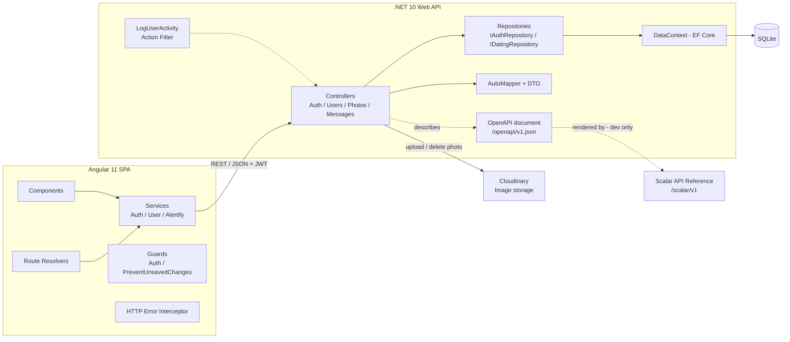
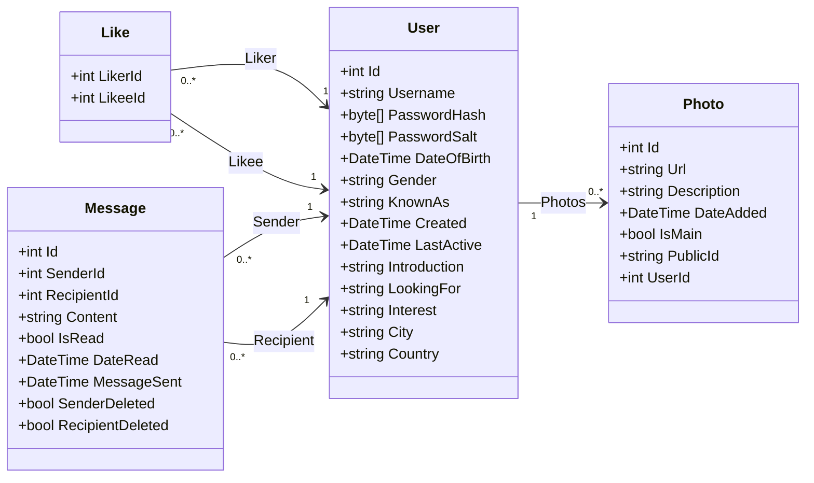
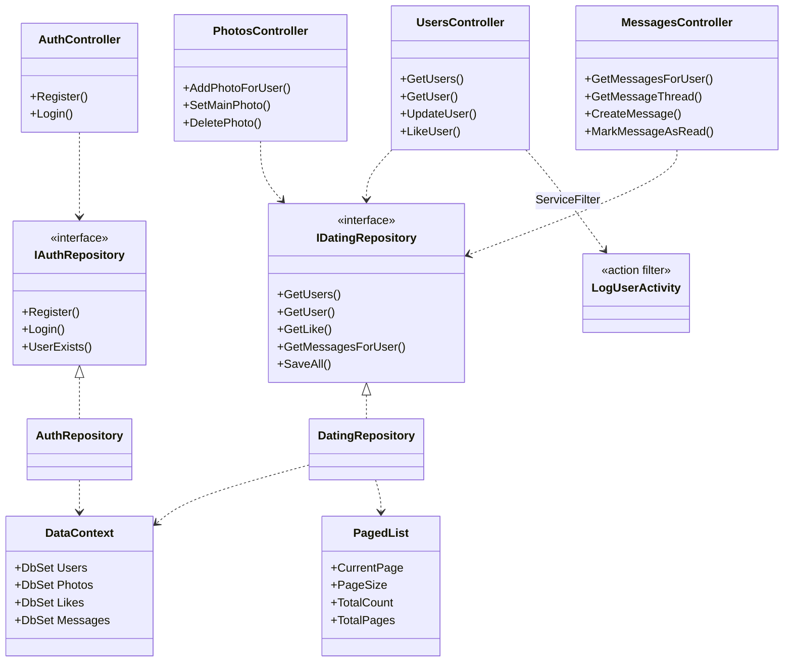
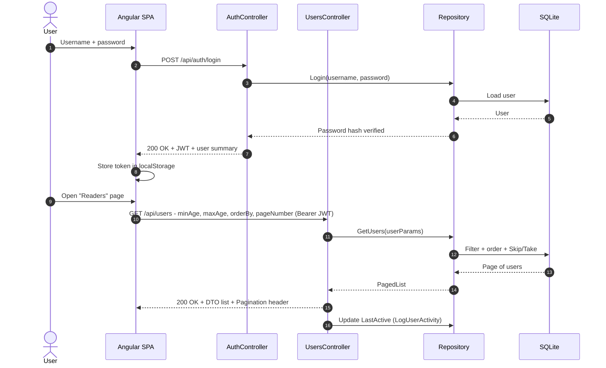
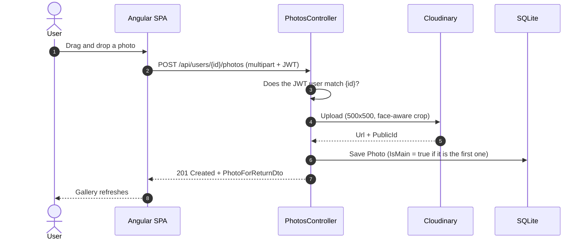

# 📚 Kim Okur?

> **A full-stack social platform where readers discover, like and message each other.**
> Built with **ASP.NET Core (.NET 10)** and **Angular**, secured with **JWT**, documented with **OpenAPI + Scalar**.


**Kim Okur?** ("Who reads?") lets registered readers build a profile, upload photos, discover other readers with filters, like them and send messages. The back end is an **ASP.NET Core Web API (.NET 10)**, the front end is an **Angular 11 SPA**. Authentication uses **JWT**, images are stored on **Cloudinary**, and the API is documented with **OpenAPI** and browsable through **Scalar**.

> The application UI is in Turkish; code, API and documentation are in English.

---

## ✨ Features

| Area | What it does |
|---|---|
| **Accounts & security** | Registration form with validation and password confirmation, JWT sessions, protected routes (`AuthGuard`), passwords hashed with HMAC-SHA512 + salt |
| **Discover readers** | Opposite-gender matches by default, **age range** filter, "Last active / New members" ordering, **server-side pagination** |
| **Reader profile** | Tabbed detail page (About, Interests, Photos, Messages), photo **gallery**, **Like** and **Message** actions |
| **Profile editing** | User and profile details, unsaved-changes warning (`PreventUnsavedChangesGuard`) |
| **Photo management** | Drag-and-drop / multi-file upload, set main photo, delete with confirmation; face-aware 500×500 crop (Cloudinary) |
| **Favourites** | "Readers I liked" / "Readers who liked me" lists, paginated |
| **Messaging** | Unread / Inbox / Outbox, conversation thread, mark as read, **soft delete** (record removed once both sides delete), relative timestamps (`timeAgo` pipe) |
| **API documentation** | OpenAPI document generated at runtime and an interactive **Scalar** reference (development only) |

## 🖼️ Screenshots

| Landing & login | Menu after login | Readers list |
|:---:|:---:|:---:|
|  |  |  |

| Reader detail & gallery | Profile details | Photo management |
|:---:|:---:|:---:|
|  |  |  |

| Delete confirmation | Delete succeeded | Main photo changed |
|:---:|:---:|:---:|
|  |  |  |

**Registration form validation** — the password must be 4–8 characters, the confirmation must match, and the **Save** button stays disabled until the form is valid:

| Empty form | Password length | Password mismatch |
|:---:|:---:|:---:|
|  |  |  |

---

## 🧰 Tech Stack

| Layer | Technology |
|---|---|
| **Backend** | ASP.NET Core Web API (.NET 10), Entity Framework Core 10, AutoMapper, Newtonsoft.Json |
| **API docs** | `Microsoft.AspNetCore.OpenApi` (OpenAPI document) + **Scalar.AspNetCore** (interactive reference) |
| **Database** | SQLite (EF Core migrations) |
| **Authentication** | JWT Bearer, HMAC-SHA512 password hashing |
| **Media** | Cloudinary (CloudinaryDotNet) |
| **Frontend** | Angular 11 (Ivy), TypeScript 4.0, RxJS 6, ngx-bootstrap 5, Bootswatch/Bootstrap 4, @kolkov/ngx-gallery, ng2-file-upload, AlertifyJS |
| **CI/CD** | GitHub Actions (build + test + lint, automatic labelling and releases, PR assignment) |

---

## 🏗️ Architecture

The SPA talks to the API over REST/JSON and sends a JWT with every request. The API is layered: **Controller → Repository → DbContext**. Entities are never exposed directly; **DTOs + AutoMapper** are used instead. In development the API also publishes an OpenAPI document that Scalar renders.



### UML — Domain Model (Class Diagram)



> `Like` has the **composite key** `(LikerId, LikeeId)`; the `Like` and `Message` relationships use `DeleteBehavior.Restrict`.

### UML — Backend Layers (Class Diagram)



### UML — Login and Paged List (Sequence Diagram)



### UML — Photo Upload (Sequence Diagram)



---

## 🔌 API Reference

In development the API serves an interactive reference built with **OpenAPI + Scalar**:

| URL | Purpose |
|---|---|
| `http://localhost:5000/scalar/v1` | Scalar API reference (opened automatically by the `KimOkur.API` launch profile) |
| `http://localhost:5000/openapi/v1.json` | Raw OpenAPI document |

Both are mapped only when `ASPNETCORE_ENVIRONMENT=Development`. All endpoints except `/api/auth/*` require `Authorization: Bearer <JWT>`; get a token from `POST /api/auth/login`.

| Method | Path | Description |
|---|---|---|
| `POST` | `/api/auth/register` · `/api/auth/login` | Register / obtain a JWT |
| `GET` | `/api/users` | Paged reader list with filters (`minAge`, `maxAge`, `gender`, `orderBy`, `likers`, `likees`) |
| `GET` · `PUT` | `/api/users/{id}` | Reader details / update profile |
| `POST` | `/api/users/{id}/like/{recipientId}` | Like a reader |
| `POST` | `/api/users/{userId}/photos` | Upload a photo |
| `POST` · `DELETE` | `/api/users/{userId}/photos/{id}/setMain` · `/photos/{id}` | Set main photo / delete a photo |
| `GET` | `/api/users/{userId}/messages` · `/messages/thread/{recipientId}` | Mailbox (`Unread` · `Inbox` · `Outbox`) / conversation thread |
| `POST` | `/api/users/{userId}/messages` · `/messages/{id}/read` | Send a message / mark as read |

---

## 💡 Engineering Highlights

- **Layered API:** Controller → Repository (interfaces + DI) → EF Core `DbContext`; DTOs instead of entities.
- **Server-side pagination:** `PagedList<T>` plus a `Pagination` HTTP header that the SPA parses to drive the pager.
- **Authorization pattern:** user-scoped endpoints compare the route `{id}` with the JWT `NameIdentifier` claim.
- **Action filter:** `LogUserActivity` updates the user's last-active time on every authorized request.
- **Self-documenting API:** runtime-generated OpenAPI document and a Scalar UI, enabled in development only.
- **Angular patterns:** route **resolvers** pre-load data, **guards** block unauthorized access and unsaved-changes loss, a central **HTTP error interceptor** handles failures.
- **Modernization:** migrated **.NET Core 2.2 → .NET 10** and **Angular 8 → 11**, with a step-by-step upgrade path toward Angular 22. Packages incompatible with Ivy were replaced (ngx-bootstrap 5, `@kolkov/ngx-gallery`, a local `timeAgo` pipe).
- **CI/CD (GitHub Actions):** `npm ci` → `lint` → `test` → `build` workflow for the SPA; PRs are labelled by branch name, a release/tag is created automatically on merge to `master`, and the PR author and merger are assigned automatically.

---

## 🚀 Getting Started

**Requirements:** .NET 10 SDK and Node.js **12–14** (Angular 11 / webpack 4 requirement; `nvm use 14` is recommended).

### 1) API

```bash
cd KimOkurAPP.API
dotnet user-secrets set "AppSettings:Token" "<random key, at least 64 characters>"
dotnet user-secrets set "CloudinarySettings:CloudName" "<cloud-name>"
dotnet user-secrets set "CloudinarySettings:ApiKey" "<api-key>"
dotnet user-secrets set "CloudinarySettings:ApiSecret" "<api-secret>"
dotnet run --urls http://localhost:5000
```

Then open **http://localhost:5000/scalar/v1** to explore the API.

The SQLite file (`KimOkurAPP.db`) is resolved from the working directory, so run the API from the `KimOkurAPP.API/` folder. For an empty database, `Data/Seed.cs` loads sample users (`UserSeedData.json`, default password `password`); the call is commented out in `Program.cs`.

### 2) SPA

```bash
cd KimOkurAPP-SPA
npm install
npm start          # http://localhost:4200
```

The SPA reads the API address from `src/environments/environment.ts` (`http://localhost:5000/api/`).

---

## 🗂️ Project Structure

```
KimOkurAPP
├── KimOkurAPP.API/          # ASP.NET Core Web API
│   ├── Controllers/         # Auth, Users, Photos, Messages
│   ├── Data/                # DbContext, repositories, seed
│   ├── Dtos/ · Models/      # DTOs and entities
│   ├── Helpers/             # PagedList, filters, AutoMapper profiles
│   └── Migrations/          # EF Core migrations
├── KimOkurAPP-SPA/          # Angular SPA
│   └── src/app/             # members, messages, lists, nav, register, _services, _guards, _resolves
├── Tanitim/                 # Screenshots
└── .github/workflows/       # CI/CD and automation
```

---

## 🛣️ Roadmap

- [ ] Angular 11 → 22 upgrade (one major version at a time)
- [ ] Fix the `MessagesController` route conflict so sending and deleting messages works
- [ ] Fix the SPA tests and `lint` errors (get CI green) and add the production `environment` settings
- [ ] Backend unit and integration tests (xUnit + `WebApplicationFactory`) and `dotnet build/test` in CI
- [ ] Add a JWT Bearer security scheme to the OpenAPI document so protected endpoints can be called from Scalar
- [ ] Minimal hosting, `System.Text.Json`, standard `ProblemDetails` error responses
- [ ] Move all secrets to `user-secrets`/environment variables, adopt ASP.NET Core Identity
- [ ] Serve the SPA from the API (Kestrel) and production configuration

---

## 👩‍💻 Author

**Nisanur** — [@NisanurBulut](https://github.com/NisanurBulut)
